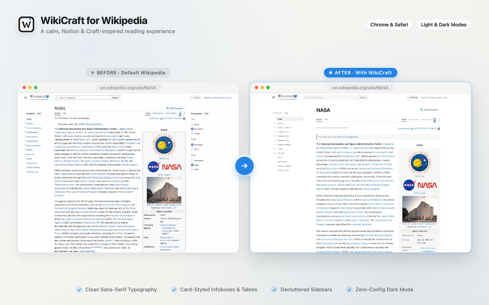
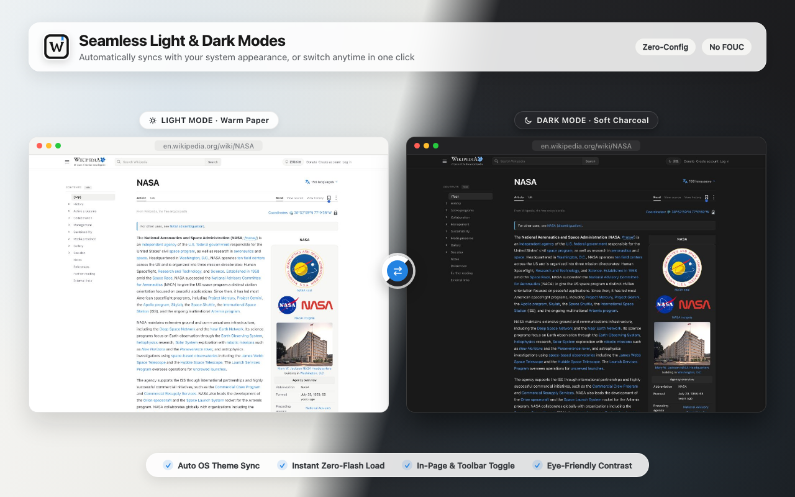

# WikiCraft — Modern Theme for Wikipedia

**English** | [繁體中文](./README.zh-TW.md)

A clean, **Notion & Craft-inspired reading theme** for Wikipedia (`*.wikipedia.org`), built with **WXT + TypeScript + Manifest V3**.





---

## ✨ Key Features

- **In-Place Typography & Layout Upgrade**: Retains all native Wikipedia functionality (editing, talk pages, language switching, and revision history) while upgrading typography, line height, and comfortable reading column width.
- **Finely Crafted Light & Dark Modes (Zero-Config)**: Pure, elegant Warm Light and Neutral Dark palettes with seamless auto-switching matching your OS appearance.
- **Zero FOUC (Flash of Unstyled Content)**: Synchronously applies cached theme CSS variables at `document_start` before the first frame paints.
- **Card-Styled Infoboxes, Tables & Navboxes**: Transforms right-hand infoboxes, data tables (`.wikitable`), and bottom navboxes into clean rounded cards, while sanitizing jarring hardcoded inline background colors.
- **Smart Sidebar Decluttering**: Automatically hides Wikipedia's redundant right-hand Appearance panel and restyles the left Table of Contents (TOC) into a sticky Notion-like outline.
- **Dual-Entry Toggle**: Switch appearance modes directly via the subtle pill button in Wikipedia's top bar, or via the toolbar popup to enable/pause the theme anytime.

---

## 🛠 Development & Build

```bash
# Install dependencies
npm install

# Start development mode (with HMR)
npm run dev

# Run TypeScript type check
npm run typecheck

# Build unpacked extension for production (dist/chrome-mv3)
npm run build

# Package zip for Chrome Web Store upload (dist/wikicraft-1.0.0-chrome.zip)
npm run zip
```

---

## 📦 Loading Unpacked Extension in Chrome

1. Run `npm run build`.
2. Open `chrome://extensions/` in Chrome.
3. Enable **Developer mode** (top-right toggle).
4. Click **Load unpacked** and select the `dist/chrome-mv3` folder inside this project directory.
5. Visit any Wikipedia article (e.g., [Taiwan article](https://zh.wikipedia.org/zh-tw/臺灣) or [English Wikipedia](https://en.wikipedia.org)) to experience the theme.

---

## 🔒 Privacy First

WikiCraft operates strictly on `*.wikipedia.org` locally in your browser. It does not collect, track, or transmit any user data or browsing history.
